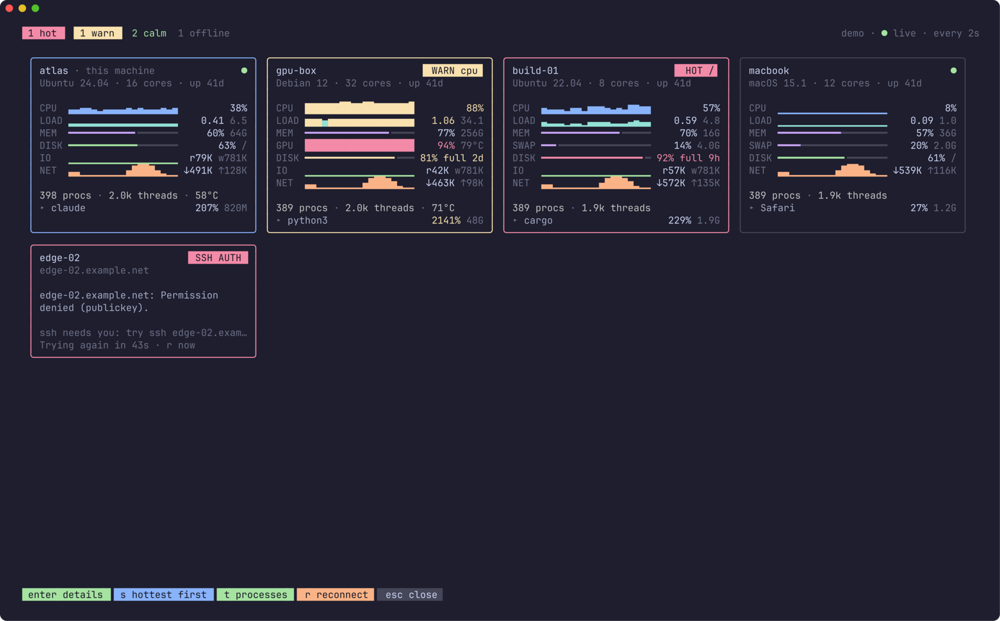
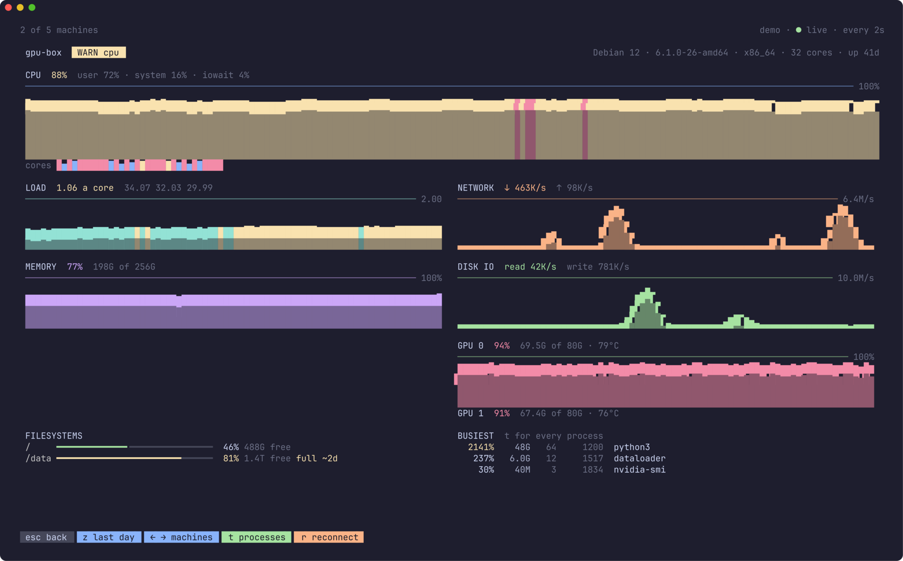
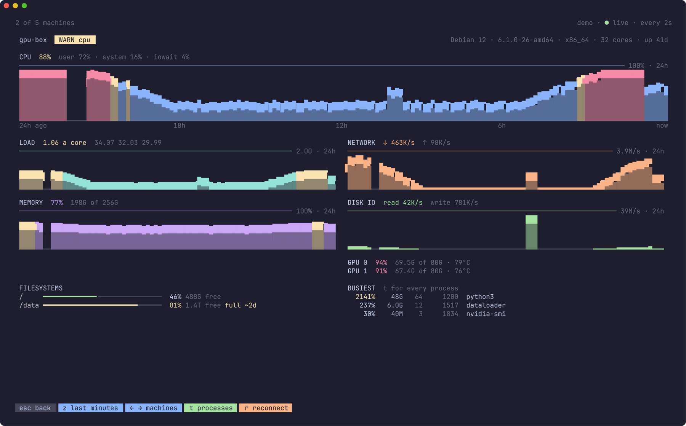
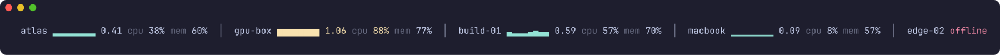

# herdr-vitals

**How your machines are doing, at a glance, before they slow your agents down.**

Agents run hot. A build, a test suite, a model training, five Claude
sessions at once: the box they're on fills its disk, runs out of memory or
spends the afternoon swapping, and you find out when everything slows to a
crawl. herdr-vitals is a [herdr](https://herdr.dev) plugin that shows every
machine you work on, the one herdr runs on and every server you ssh to, as
a card: CPU, load, memory, disks, network and what's busiest, live. And it
tells you when one runs low.



- **One look, every machine.** A card each, with graphs of the last few
  minutes. Calm is quiet, each reading in its own colour; what wants a look
  turns yellow, what wants you now red, and the card says why in its corner
  (`HOT /data`, `WARN swap`).
- **Disks before they're full.** Every filesystem's use is written down, and
  from how fast it's been filling comes when it will be full: `81% full 2d`.
- **A toast when one runs low.** CPU flat out for two minutes, memory above
  90%, a disk 90% full or full within a day. Once, and not again until it
  eases off.
- **Load that means something.** Shown a core: 1.00 is every core busy,
  more is work waiting. 34 on 32 cores and 4 on 4 read the same.
- **A day to look back on.** `z` turns the graphs to the last 24 hours: the
  busy afternoon, the backup at three, when the disk started to fill.
- **Every process**, the whole screen, by CPU or by memory (`t`).
- **Nothing to install on your servers.** A few lines of shell over ssh,
  one connection a machine, reading `/proc` (Linux) or `sysctl` and
  `vm_stat` (macOS). Your ssh config and keys, as they are.
- **Graphs full the moment it opens.** A sampler keeps reading in the
  background, lightly: about 0.1% of a core for this machine.
- **A popup or a pane.** Glance and close, or keep it beside your agents;
  a pane a line high is one line of every machine's load.
- **It fits in.** Follows herdr's theme, works with the mouse. Linux and
  macOS.

## Works with the other herdr plugins

This is one of six plugins that are useful alone and better together.
Install [herdr-recap](https://github.com/mrolafsson/herdr-recap), [herdr-github](https://github.com/mrolafsson/herdr-github), [herdr-linear](https://github.com/mrolafsson/herdr-linear), [herdr-snooze](https://github.com/mrolafsson/herdr-snooze) or [herdr-file-transfer](https://github.com/mrolafsson/herdr-file-transfer) alongside it and they find each other:
there is nothing to configure.

| Plugin | What it adds to the others |
| --- | --- |
| [herdr-recap](https://github.com/mrolafsson/herdr-recap) | Every agent in one list. An agent's pull request and its Linear issue are links there: a click, or `ctrl+g` / `ctrl+l`, opens it in the plugin it belongs to. Snoozed agents have a tab of their own: `ctrl+s` snoozes an agent, in Snooze's popup, and `ctrl+w` wakes one. |
| [herdr-github](https://github.com/mrolafsson/herdr-github) | Tags every space and agent with its branch's pull request (`#482 ✓ approved`), which Recap shows and groups its agents by. Opens straight on an agent's PR when Recap asks. |
| [herdr-linear](https://github.com/mrolafsson/herdr-linear) | Tags every space and agent with the Linear issue its branch is named for (`ENG-142 In Progress`), which Recap shows. Opens straight on that issue when Recap asks. |
| [herdr-snooze](https://github.com/mrolafsson/herdr-snooze) | Hides an agent, or a whole space, from herdr's Agents panel until a time you pick, or until the agent's done or its pull request is merged (from herdr-github's labels). Tags each snoozed agent with when it wakes (`💤 17:30`, `💤 till done`), which Recap shows. Opens straight on an agent when Recap asks, and opens Recap on one with `r`. |
| **[herdr-vitals](https://github.com/mrolafsson/herdr-vitals)** (this one) | How the machine is doing: right of Recap's tabs, a small graph of its CPU and a gauge of its memory, yellow from 80% and red from 90%, when there's room. A click on it opens Vitals on every machine you work on, and `esc` comes back. |
| [herdr-file-transfer](https://github.com/mrolafsson/herdr-file-transfer) | Files between the machine you're at and the server herdr runs on. Chooses the files a new Linear issue attaches (`ctrl+f` in herdr-linear's form): any on the server, or one brought over from your Mac, or from an iPad with Taildrop. |

- **Auto-discovery.** Each plugin asks herdr which others are installed and
  enabled. A link only appears when the plugin behind it is there; without
  it the same text is shown, as text, and its key is left out.
- **Clickable, and there and back.** herdr shows one popup at a time, so
  following a link turns the open popup into the other plugin's, in place and
  without a flicker, and `esc` there brings you back to where you were.
- **Shared look.** A title, a branch, a pull request and a key are
  drawn the same in all six, in herdr's theme colours.

See [With Recap](#with-recap) for how the two meet.

**Contents:** [Works with the other plugins](#works-with-the-other-herdr-plugins) ·
[Requirements](#requirements) · [Install](#install) · [Use](#use) ·
[Disks](#disks) · [Toasts](#toasts) · [Which machines](#which-machines) ·
[With Recap](#with-recap) · [Configuration](#configuration) ·
[Troubleshooting](#troubleshooting) · [How it works](#how-it-works) ·
[Development](#development)

## Requirements

- **herdr 0.9.0** or later.
- **Linux** or **macOS**, on arm64 or x86-64; the same for the machines it
  watches over ssh, which need only `sh` and the usual tools.
- **ssh access** to the other machines, without a prompt: a key loaded in
  your agent (`ssh-add`), or herdr's own saved machines.

## Install

```sh
herdr plugin install mrolafsson/herdr-vitals
```

The build step compiles it with Go if you have it, or downloads the release
binary for your platform and checks its SHA-256.

Then bind the keys you want in `~/.config/herdr/config.toml`. Nothing in a
herdr manifest can add key bindings for you, so **without this step the
plugin is installed but you have no way to reach it** except the command
palette and the command line.

```toml
[[keys.command]]
key = "prefix+alt+v"
type = "plugin_action"
command = "herdr-vitals.open"
description = "Vitals: your machines"

[[keys.command]]
key = "prefix+alt+shift+v"
type = "plugin_action"
command = "herdr-vitals.pane"
description = "Vitals: keep in a pane (again to close)"
```

On macOS, `alt` needs Option to send Alt in your terminal (Ghostty:
`macos-option-as-alt = true`).

Then `herdr server reload-config`, and **start a new herdr client** (detach
and run `herdr` again): a client that was already open keeps the key
bindings it started with. Pick any keys you like; these are free in herdr's
default bindings.

`Vitals: demo (fictional machines)` in the command palette shows it on
made-up machines: safe to try, safe to screenshot.

### From a local checkout

```sh
git clone https://github.com/mrolafsson/herdr-vitals
herdr plugin link ./herdr-vitals
```

`herdr plugin link` runs the build step (`scripts/build.sh`) the first time;
after editing the code, `go build -o bin/herdr-vitals .`.

## Use

`prefix+alt+v` opens the popup: a card a machine, the selected one outlined.
Enter, or a click on the selected card, opens its details: the CPU over the
last minutes and every core, load, memory and swap, network and disk
traffic, GPUs, each graph framed by a rule saying what reaches its top;
every filesystem, and the busiest few processes.



`z` turns the graphs to the last day, a point a minute, with gaps where
herdr wasn't running:



With only one machine to watch, the monitor is its details.

### Keep it in a pane

`prefix+alt+shift+v` opens the monitor in a pane beside yours, and leaves
you where you were; the same key closes it. From the popup, `p` does the
same. Narrow, the cards stack; a line or two high, it's one line, each
machine's load a core and a small graph of it:



### Keys

| Key | |
| --- | --- |
| arrows, `hjkl`, `tab` | Choose a machine. In the details, `←` `→` go to the next. |
| `enter`, a click | Its details; again to go back. |
| `z` | In the details: the last day, or the last few minutes. |
| `t` | Every process on the machine, the whole screen; `m` sorts by memory or CPU. |
| `s` | Hottest first, or as listed. |
| `r` | Reconnect what's down, now. |
| `p` | Keep it in a pane (from the popup). |
| `esc` | Back, or close the popup. `q` closes the pane. |

## Disks

Every filesystem's use is written down every few minutes, kept for a
fortnight, and from how fast it's been filling over the last three days
comes when it will be full. A card shows the filesystem that most wants
you: the one filling soonest if one will be full within the week
(`81% full 2d`), else the fullest. Within a week it's a warning; within a
day, hot. It needs two hours of records before it says anything, and says
nothing of a disk that's emptying, or won't fill within a month.

How full is as `df` has it: of the space you can use, the blocks kept back
for root not counted, so 100% is when writes fail.

## Toasts

A herdr toast, for any machine, when:

| | |
| --- | --- |
| **CPU** | above 90% for the last two minutes (not a spike) |
| **Memory** | above 90% |
| **A disk** | 90% full, or full within a day at the rate it's filling |

Each is said once, and not again until it has eased off well below the line
(below 80%; a disk's fill past two days), so a machine hovering at the line
doesn't toast on and off. What's been said is kept, so restarting herdr
doesn't say it all again. `"alerts": false` turns them off.

## Which machines

- **This one**, the machine herdr runs on.
- **herdr's saved machines** (`herdr machine list`), by the names you gave
  them. If ssh needs you to log in again, the card says to run
  `herdr machine reconnect <name>`.
- **Any others** you name in `config.json` (see
  [Configuration](#configuration)).

A host is anything `ssh` takes: a name from your ssh config, `user@host`,
or an `ssh://` URL with a port. ssh never asks for anything (`BatchMode`),
there being nobody to answer: load your key with `ssh-add`, and accept a
new host's key with a plain `ssh` once. A machine that's down says so on its
card, and why, and is tried again, sooner at first; `r` tries now.

## With Recap

With [herdr-recap](https://github.com/mrolafsson/herdr-recap) installed, the
space right of its tabs shows how the machine is doing: a small graph of
its CPU and a gauge of its memory, as there's room for them (never at the
tabs' expense). A click on it turns Recap's popup into this one, and `esc`
here goes back to Recap, on the agent you were on.

The convention, for plugin authors: `herdr-vitals stream` writes this
machine's `{"cpu", "mem", "load", "cores"}` as a JSON line a second, the
last couple of minutes first; the popup is the `picker` pane, and goes back
to the popup in `HERDR_POPUP_RETURN` when it closes.

## Configuration

`config.json` in the plugin's config folder (`herdr plugin config-dir
herdr-vitals`); see [config.example.json](config.example.json).

```json
{
  "hosts": [
    "gpu-box",
    { "name": "build", "ssh": "ci@build-01.example.net" },
    { "name": "edge", "ssh": "ssh://me@edge.example.net:2222" }
  ]
}
```

| Setting | Default | |
| --- | --- | --- |
| `hosts` | none | More machines to watch, over ssh: a target, or a name and a target. |
| `herdr_machines` | `true` | Watch herdr's saved machines. |
| `local` | `true` | Watch the machine herdr runs on. |
| `interval_seconds` | `2` | How often each machine is read. |
| `background` | `true` | Keep the sampler running: full graphs on opening, the last day, the toasts. |
| `alerts` | `true` | Toast when a machine runs low on CPU, memory or disk. |
| `theme` | ask the terminal | `"dark"` or `"light"`. |

## Troubleshooting

**A machine says SSH AUTH.** ssh couldn't log in without asking: load your
key (`ssh-add`), or for a new host accept its key with a plain `ssh` once.
For one of herdr's saved machines, `herdr machine reconnect <name>`.

**A machine says OFFLINE.** ssh couldn't reach it; the card says what ssh
said. It's tried again by itself; `r` tries now.

**The graphs start empty.** The sampler isn't running, or was just started:
`herdr-vitals sampler --detach` starts it, and opening the monitor does too.
Check `"background"` isn't `false`.

**`herdr-vitals list`** prints one reading of every machine as text, to set
beside `top`, `free` and `df`.

## How it works

A small POSIX shell script, the same here and on every server, loops
printing what the kernel says (`/proc/stat`, `/proc/meminfo`,
`/proc/loadavg`, `/proc/net/dev`, `/proc/diskstats`, `df`, the temperature
sensors, `nvidia-smi` when there is one, and each process's CPU time,
memory and threads), one ssh session a machine held open. On macOS it reads
`sysctl`, `vm_stat`, `netstat`, `df` and `ps` instead. Rates are the
difference between two readings, worked out here. Traffic counts real
interfaces only (not loopback, containers or VPN tunnels, which would count
it twice) and whole disks (not their partitions).

The sampler is the same, lighter: no processes or temperatures, and this
machine read straight from `/proc`, with no shell. herdr's startup hook
starts it, detached; a lock keeps it to one; it goes when herdr does, and
starts again as the new program when the plugin's updated. It keeps the
last few minutes and the last day of every machine, a file each under the
plugin's state folder, which is where the popup, the pane and Recap's
header start from.

## Development

```sh
go test -race ./...
go run . picker --demo       # the popup on fictional machines, in any terminal
go run . list                # one reading of every machine, as text
herdr plugin link .          # try it in herdr
sh scripts/screenshots.sh    # docs/images from the demo (needs freeze)
```

`themes_herdr.go` is generated from herdr's palettes by herdr-recap's
`scripts/gen-themes.py`, and `look.go` is the file the herdr plugins share:
change it in all of them.

### Releasing

Bump `version` in `herdr-plugin.toml`, then tag it: `git tag v0.2.0 && git
push --tags`. The release workflow checks the tag matches the manifest, runs
the tests and publishes the binaries `scripts/build.sh` downloads when Go
isn't installed.

## License

[MIT](LICENSE)
