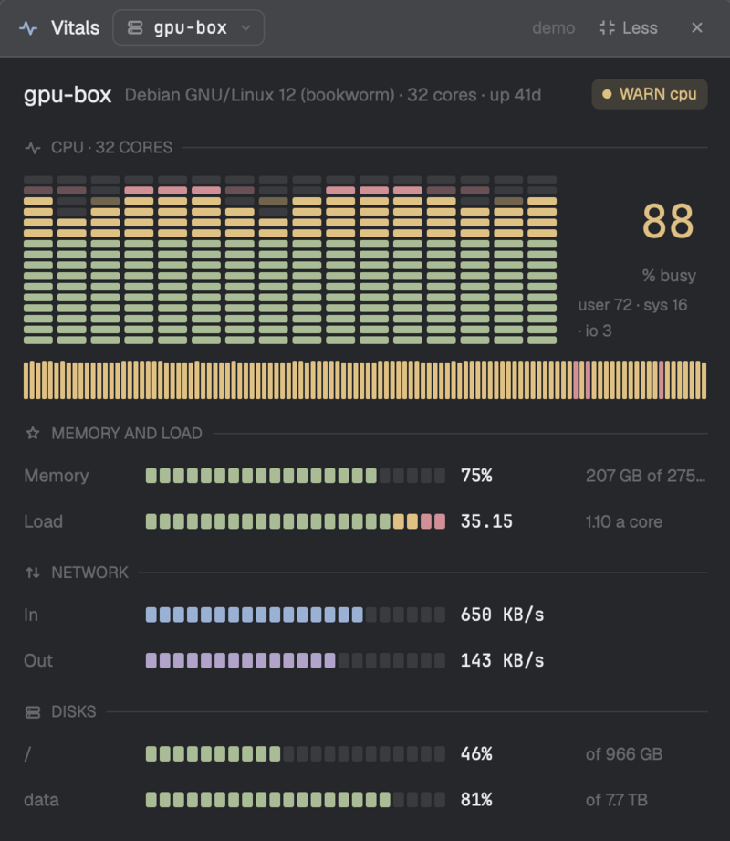

# Vitals

How the machine your agents run on is doing, live, in a window that stays beside your work. Its CPU as a graphic equalizer, a band a core lit green, yellow then red with peaks that hold and fall, memory, load and network as meters, and its disks, with a word on how it's doing: OK, or WARN and HOT and why. It starts on the machine of the agent you're in, and a dropdown shows any other the app is connected to. Compact when you just want the CPU, memory and disk at a glance.

Agents run hot: a build, a test suite, five Claude sessions at once, and
the box fills its disk or runs out of memory while you're looking at
something else. This window (⌘⌥V) keeps one eye on it for you:

- **CPU as an equalizer.** A band a core (past 24, neighbours share one),
  lit segment by segment from the bottom in the theme's green, yellow and
  red, each band's peak a faded segment that holds a moment and falls. A
  Mac doesn't say a core's share without root, so there the bands are the
  last 40 seconds of the whole CPU.
- **Meters** for memory, swap, load and network, all the same width,
  segment for segment; each disk, with how full it is.
- **A word on its health:** OK, WARN or HOT, and what it is.
- **Any machine:** this one, or any the app is connected to, from a
  dropdown beside the title.
- **Compact or normal,** a click in the title bar.
- **Light:** a reading every 2 seconds while it's open, nothing when it's
  closed.

## What it is

A window mod (`mod.json`: an overlay window, `key: "vitals"`, kept: it
comes back where it was left, on the next start too, until closed), opened
with ⌘⌥V. It's the Herdr app's side of
[herdr-vitals](https://github.com/mrolafsson/herdr-vitals), whose code reads
the machines.

## Installing it (for the agent adding it)

1. Copy `mods/vitals/` to `~/.config/herdr-app/mods/vitals/`.
2. Merge `keys.json` into the person's: add its sections and keys; ask
   before replacing a key they already bind to something else. (On macOS,
   ⌘⇧V is often a clipboard manager's: that's why it's ⌘⌥V.)
3. `herdr-app check ~/.config/herdr-app/mods/vitals`.

**Already installed? That's an update, not a clash.** If `mods/vitals/`
exists and is this mod (its `main.js` sets `VITALS_VERSION` and fetches
herdr-vitals), replace its files with these, in place: don't install a
second copy under another name. Its keys are merged already; step 2 only
adds any new ones.

**A different mod named `vitals`?** Then rename this one, and everything
that names it follows: the folder; `ICONS` in `look.js`
(`mods/<name>/icons`); in `mod.json`, the overlay's `key`; in `keys.json`,
the section `mod:vitals`, its action `vitals.close`, and `mod.open:vitals`.

That's all. **Don't install herdr-vitals, or anything else, on any
machine:** the mod fetches the herdr-vitals release it needs onto each
machine it reads by itself, the first time. What it needs there: `curl`,
`tar` and `sha256sum` or `shasum`, which macOS and Linux have.

To see that it works: open it (⌘⌥V). The first reading of a machine takes
a few seconds longer while herdr-vitals is fetched; then the equalizer
moves every 2 seconds. `herdr-app do vitals.demo`, while it's open, shows
made-up machines.

## What it does, and asks

- Runs `herdr-vitals app` (one JSON request in, one answer out) through
  `exec(…, { on: machine })` on the machine shown, every 2 seconds while
  the window is open: about 5 ms of CPU a reading on Linux (read from
  `/proc`), about 60 ms on a Mac (a round of `top`, `vm_stat`, `sysctl` and
  `df`).
- **Runs programs and reaches the network:** the first time it reads a
  machine, it downloads the herdr-vitals release it names
  (`VITALS_VERSION` in `main.js`) from GitHub for that machine, checks it
  against the release's `checksums.txt`, and keeps it in
  `~/.local/share/herdr-vitals/app/<version>/`, apart from any TUI install.
- Starts herdr-vitals' sampler there if it isn't running (on Linux, as a
  systemd user unit of its own), for the history strip; it keeps going
  while the window is in use, and ten minutes after, or while herdr's TUI
  runs. It shares its history with the TUI plugin.
- Reads `agents()` and `spaces()` to start on the machine of the agent
  you're in, and `machines()` for the dropdown.
- Keeps, in its own `localStorage`, whether it's compact.

## Its look

Recap's, GitHub's and Linear's: neutral surfaces, colour only on what a
reading means, the theme's own green, yellow and red (its ANSI colours),
the accent and magenta for network in and out. The equalizer and meters
are segments, rounded a little, unlit ones a faint line colour; peaks a
faded segment. Drawn icons in `icons/`, 16px with a 1.6 stroke. JetBrains
Mono for numbers and machine names. The window is 480px wide; normal 720px
tall and scrolling under its title bar, compact as tall as what's in it.

## Keys (`keys.json`)

`cmd-alt-v` opens it; `escape` closes the machine dropdown, then the
window. The dropdown, Less/More and ✕ are clicks. `vitals.next` and
`vitals.prev` (with `herdr-app do`, while it's open) show the next or
previous machine; `vitals.demo` switches to made-up machines.
